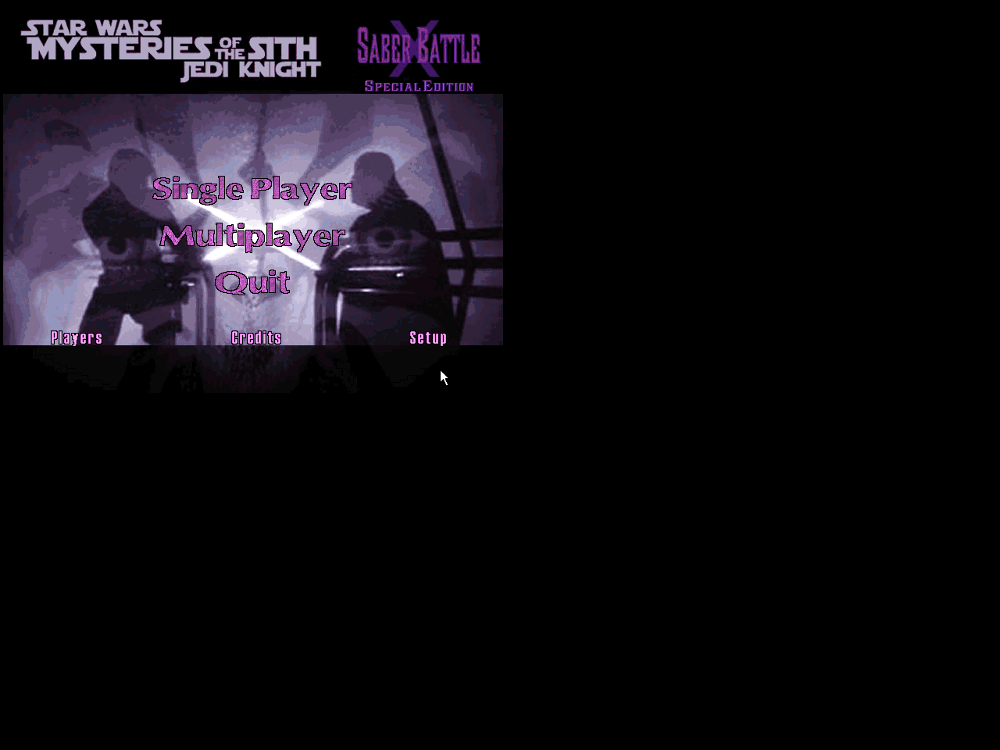

# Special Edition v1.2.0 validation — 26 October 2026

The target is original **Mysteries of the Sith `JKM.EXE`**, not a claim that the MotS GOO runs in the original JK `JK.EXE`.

## Final Special Edition archives

| Edition | Members | Bytes | SHA-256 |
| --- | ---: | ---: | --- |
| Accelerated | 2,231 | 47,437,733 | `d280ddfe89c7ecec950fe64c459e8e9f319b593f35206d861848070a3471539a` |
| Software | 2,231 | 46,906,341 | `0cffe0dbb703dab7be9f154d71b5a49d553098b015d38355711b012cc0f118a7` |

Two clean Special Edition builds reproduce both GOOs byte-for-byte. Their member names are identical to the tested gameplay baseline below; only `ui/bm/bkmain.bm` changes. Every script, animation, model, texture, sound, inventory table and other resource remains byte-identical. Each final GOO resolves 3,479 resources against ordinary MotS with zero missing file references.

The native bitmap retains its complete header, dimensions and embedded palette. Exactly 8,819 pixel indices change within the right title block, bounding rectangle `[450, 2, 615, 97)` in the 640x480 image. All pixels outside that rectangle remain byte-identical. The original logo is translated upward 17 pixels without resampling; the added subtitle uses the existing palette. The new BM SHA-256 is `948ec8c96517f7e049a561785c5efe98b8e3c367aba20b4fc0442e395001b85b`.

Thirteen behavioral tests pass: the original packaging cases plus bitmap structure/palette checks, duplicate-palette-index preservation, title-region isolation, unchanged gameplay bytes, and early refusal to create bulk build output inside a Git checkout. The early build-location guard was added before the second final build and did not change any GOO bytes. Details are in `docs/audit/special-edition-1.2.0/` and `assets/ui/encoding-receipt.json`.

## Native Special Edition title verification

Original unmodified JKM.EXE launched the final accelerated GOO twice for menu verification. Main and Players display the subtitle without clipping or overlap. Single Player, Setup and Controls navigation succeeds. All 62,080 RGB pixels of the retained Main header match the decoded final BM exactly. Conflicting tool thumbnails were resolved through direct file comparison; the retained capture contains the complete title. No gameplay was re-entered for this title-only change.

The software edition contains exactly the same BM; its remaining resources match the previously exercised software gameplay package. A redundant software title launch was not performed. Both UI lanes stopped with their exact owned PIDs absent and unchanged input/executable/archive hashes. See `docs/audit/special-edition-1.2.0/NATIVE-UI-REVIEW.json` and `native-header-pixel-proof.json`.

## Tested gameplay baseline before the subtitle

| Edition | Members | Bytes | SHA-256 |
| --- | ---: | ---: | --- |
| Accelerated | 2,231 | 47,437,733 | `ec02b0588233d96f026ffeb0b4eafa05677fd8700c158a2ff06eb3c54fed2111` |
| Software | 2,231 | 46,906,341 | `efc87afa15a03d8ad31616fd96b0d2b82d8a7b2dbcdec9a928cd30ca742bc6c3` |

Each edition is a complete alternative single GOO. Ordinary owned MotS supplies its normal game resources; no separate SBX 3.0/3.1 archive participates at runtime. The game executable is unchanged: SHA-256 `23cd064217f904d36d896f52d3cdd17635bb85441a12e0415c0637504191d974`.

## Merge and attachment verification

The attached 25 October GOB has SHA-256 `b0ad90b06fc76efd6641d286ff11a27c7f66b94db05c4b33a53fb1287f9e97e6`, exactly the input pinned by merged GitLab request !1. The untouched merge at `26fc8d82af25a61b3a57896af159ae0ee4f38500` was rebuilt locally: 651 overlay members and hash `5c8b0d3b7d8ec0b539614b6d9083fc1a7b1837ed4f08ec4ca28b1a5f27a130f1`, exactly its reported result.

Every member of that verified merge remains byte-identical in the new overlay. Only `cog/actor_mn.cog` is added, fixing an inherited missing voice reference through the original JK equivalent that the merge already bundled. The resulting overlay has 652 resources. Standalone packaging then folds in the SBX base with the same precedence.

The incoming 37 empty `rt_` placeholders never enter the runtime package. All 39 prepared `rt_` keys have real node data and nontrivial duration; all 16 copied authored attack/dash keys match the attachment. Runtime COGs contain no `jkSetFlags`/`jkClearFlags` use of the browser reverse-grip mask `0x200`. Ordinary KEY entries rotate anchors 18/19 instead. Raw diagnostic flag values alone are not evidence of an engine extension being used.

## Executed static and reproducibility checks

- Two clean full builds reproduced the overlay, optional material layer, accelerated GOO and software GOO byte-for-byte.
- Each complete package resolves 3,479 reachable resources with zero missing file references, starting from every packaged member and consulting only stock MotS resources/sounds. This is lexical reference closure, not a proof of every possible dynamic script path.
- Archive readback equals the intended complete base/overlay/material precedence exactly; the convenience mod folder contains one GOO.
- Seven behavioral packer tests pass, including deterministic archives, precedence, complete software alternatives, preservation, rejecting inherited/new missing references, existing-output protection, and rejecting non-material software overrides.
- All 23 changed/generated COGs pass the measured original-MotS native spelling/message preflight with zero availability findings. It is not a compiler or gameplay test.
- The existing native reference/hierarchy/inventory checks pass. The independent source/byte review checks the final archive, not only documentation claims.

## Original-executable execution

The original executable runs under Wine in an isolated private Xvfb display, using legitimate owned game resources and media mapping. There is no executable modification. Accelerated rendering uses Wine/Mesa llvmpipe; this does not test a physical Windows GPU. Tests use a private controlled map/diagnostic COG, excluded from the deliverable. Direct diagnostic selection and actual attack/movement input are distinguished below.

| Check | Observed result |
| --- | --- |
| Standalone launch and UI | Original JKM boots with the new GOO as its only mod archive. Fresh ordinary player-profile, main, Single Player, Setup, Controls and Keyboard screens are captured with developer menus/windows disabled. |
| Accelerated renderer | Native Display screen explicitly shows 3D acceleration checked and 1280x960 16bpp, before gameplay. |
| Reverse grip | Both native blades point backward with the prepared upper-idle anchor rotation. |
| Primary and alternate attacks | Real Ctrl/Z inputs play the primary motion and alternate hop/spin, returning to reverse idle. Stance was initially granted/selected by the private diagnostic. |
| Dash | Real Shift+W input reaches automatic trigger 1441; slowing at a wall returns through trigger 1440. This establishes entry/exit, not exhaustive dash-pose coverage. |
| Repeated movement/attack pressure | Repeated primary input while moving and repeated hop/spins recover to idle without an observed freeze/crash in this bounded run. Fully saturated blocking-track exhaustion was not forced. |
| Software renderer and lifecycle | The complete software GOO runs under the native indexed renderer. Staff, Sariss, dual/Boc and reverse stances render; reverse blades extinguish and relight. Direct diagnostic calls perform this sequence. Raw inventory switches to single/long/Sith bins 131/139/125 are observed. The final return is unlit, so this does not prove lit reverse restoration after switching weapons. |
| Native reverse-grip damage | A stationary diagnostic target starts at 500 health; ordinary Ctrl/Z attack input reduces it to 450. The inspected diagnostic contains no `DamageThing` or other scripted damage. This demonstrates actual damage in that case, not per-attack balance, both blades independently, every collision direction or multiplayer damage. |

All gameplay/diagnostic maps and COGs are excluded from the delivery. Existing v1.0 evidence is preserved in historical documentation and is not relabeled as new-stance testing.

## Scope and limits

Connected multiplayer, mixed-installation compatibility, full campaign progression, complete save/load, all 178 skins/attacks, all Force interactions, audible footstep/voice listening and physical GPU rendering are not certified by these tests. The ordinary player-profile menu is not multiplayer skin-selection coverage.

Retail keeps native blade glows, full-duration attack cooldowns and the inherited first-person staff view. Browser mesh fan/overlap behavior is not identical. The shared reverse idle uses Kyle's anchor positions: 175/178 skins are within 0.0001 game units of their per-skin value; the maximum measured difference is about 0.000707. This is a measured approximation, not an exhaustive visual fit acceptance.

Retain SBX's save precaution: extinguish the saber before saving; switch it off/on if a loaded saber loses damage. No engine patch or separate SBX installation is required by the tested standalone configuration.

## Test cleanup and source preservation

All four task-owned test lanes have stopped. Each case recorded unchanged source input hashes, and cleanup was scoped to its own Wine prefix, game process, private display and audio process. The software lifecycle lane reached its bounded deadline; the others received a queued stop. Game-process termination during scoped cleanup is not represented as an application quit or a gameplay pass. Observed behavior and remaining limits are recorded separately in `docs/audit/standalone-2026-10-26/RUNTIME-OBSERVATIONS.json`.
