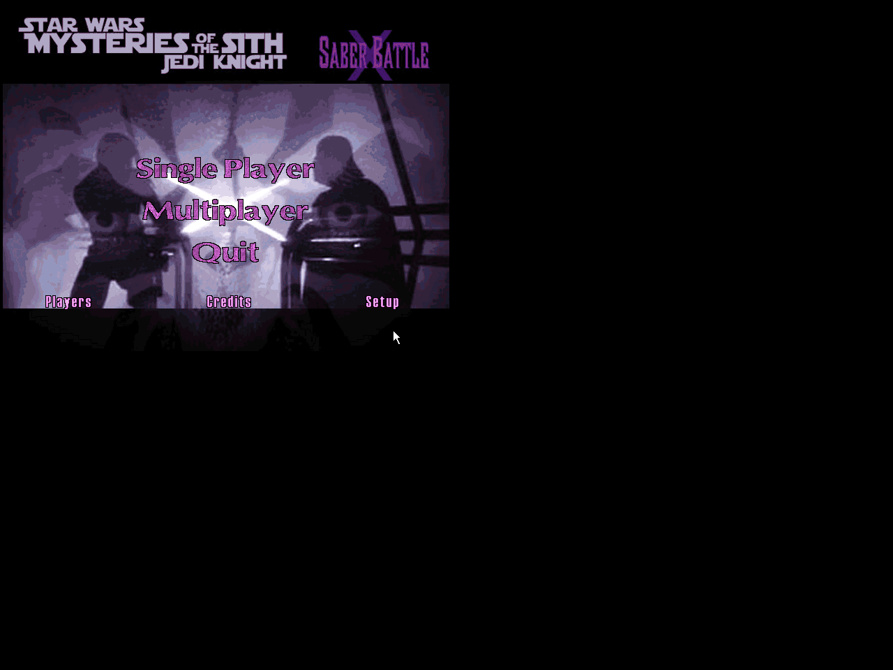
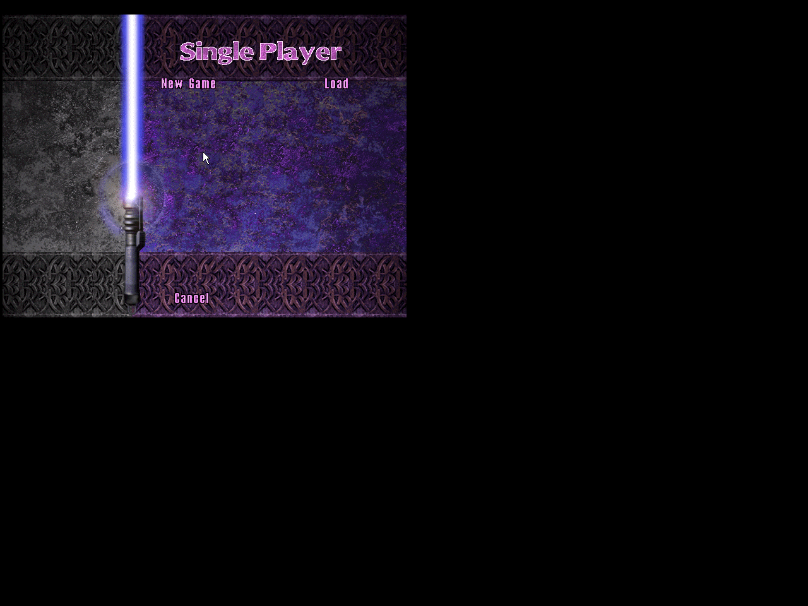
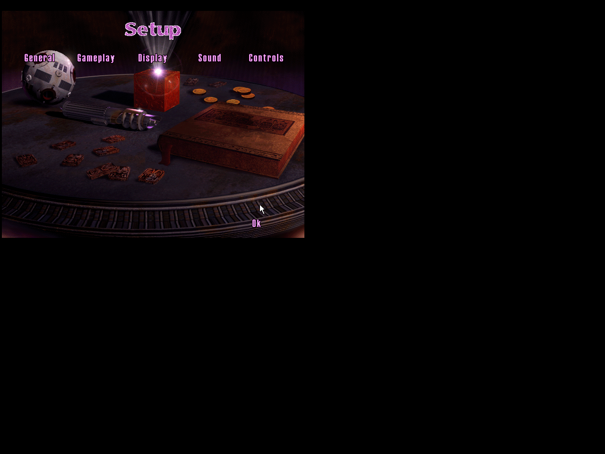
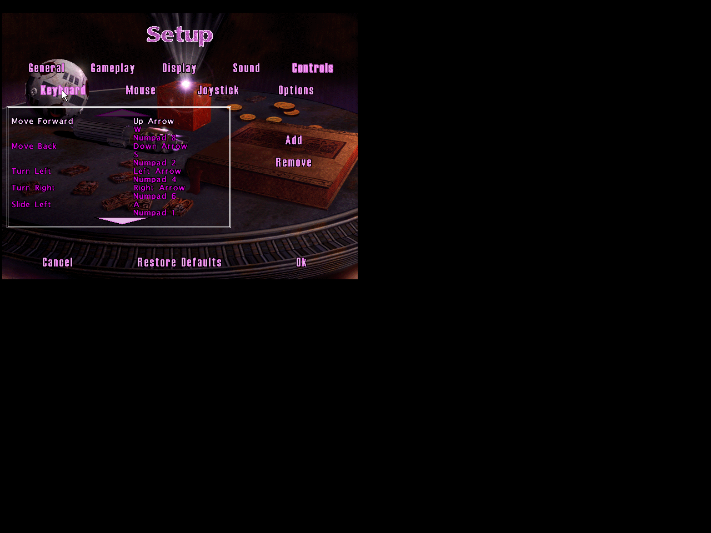

# Special Edition v1.2.0 UI

## Final Special Edition in original JKM.EXE

The final GOO renders the subtitle without clipping or overlap. The complete retained Main header matches the final native bitmap exactly. Players, Single Player, Setup and Controls captures are retained in the same evidence folder. These are unedited private-display screenshots.

## Prior standalone baseline

The screenshots below establish the pre-subtitle standalone UI baseline. They are fresh screenshots of original, unchanged MotS `JKM.EXE` using the new standalone GOO as its only mod archive. They were captured on a private headless display, not Andrei's Windows desktop. The black area around the original 640-pixel-wide menu is unused test-display space; no screenshot pixels were edited. Developer menus/windows were disabled for this preview.

## Main menu

## Single player

## Setup

## Keyboard controls

[Player profile screen](docs/evidence/standalone-2026-10-26/ui-players.png) and [controls landing screen](docs/evidence/standalone-2026-10-26/ui-controls.png) are included too. The profile screen is not multiplayer skin-selection validation.

The release keeps the inherited SBX/MotS design and native control positions. It adds a small subtitle to the main title block, moves the original right-hand logo upward 17 pixels without resampling, and preserves the embedded palette. Art and native bitmap provenance are retained in `art/special-edition/` and `assets/ui/`. Native final-title verification accompanies the release validation.
